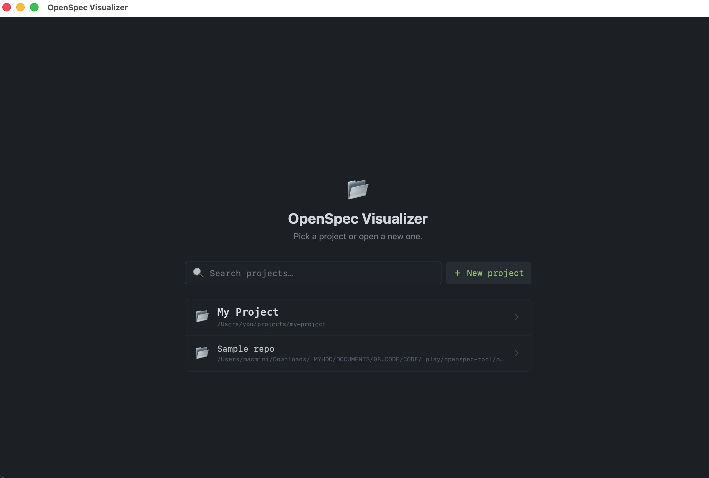
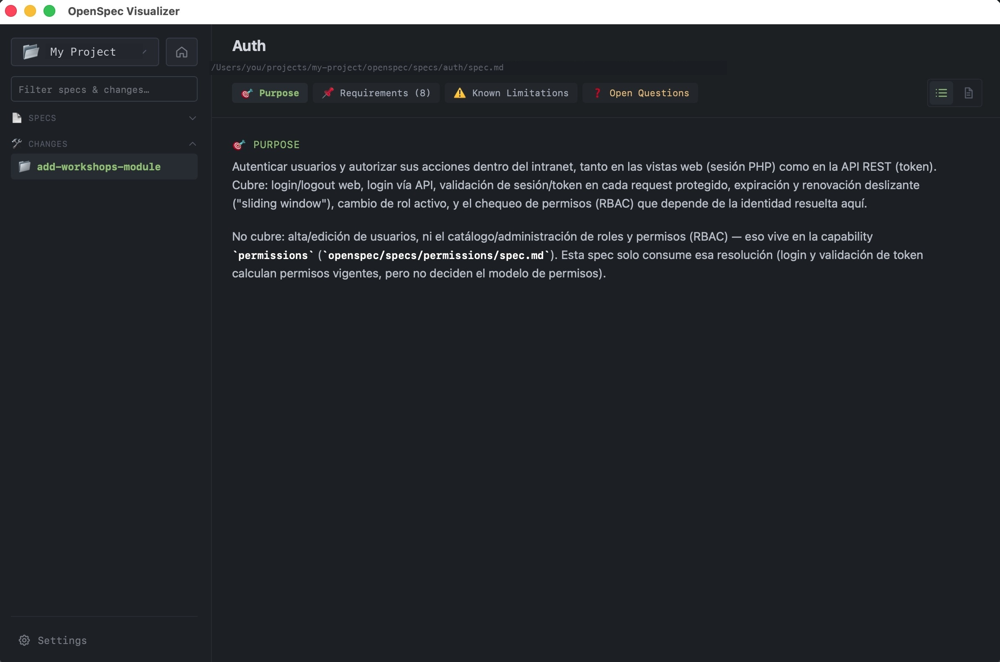
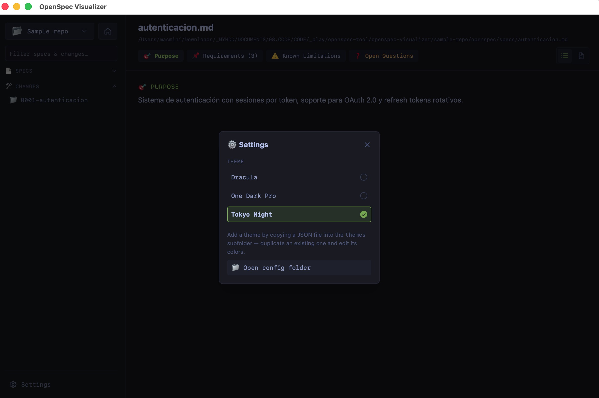

# OpenSpec Visualizer

A desktop app for browsing and editing [OpenSpec](https://github.com/Fission-AI/OpenSpec)-style
`specs` and `changes` folders — spec requirements, scenarios, change proposals, tasks, and open
questions — through a clean, themeable UI instead of raw markdown files.

Built with [Tauri v2](https://v2.tauri.app/) (Rust) + [Vue 3](https://vuejs.org/) + TypeScript.

<p align="center">
  
  
</p>

## Requirements

To build and run this project from source you need:

- **Node.js** 18 or newer
- **pnpm** (this repo uses pnpm, not npm/yarn) — install with `npm install -g pnpm`
- **Rust** (stable toolchain) — install via [rustup.rs](https://rustup.rs/); Tauri compiles a native
  binary, so a working Rust/Cargo installation is required even though the UI is written in
  TypeScript
- Platform-specific native dependencies required by Tauri:
  - **macOS**: Xcode Command Line Tools — `xcode-select --install`
  - **Windows**: Microsoft Visual C++ Build Tools, and the WebView2 runtime (preinstalled on most
    Windows 10/11 machines; Tauri will prompt to install it otherwise)
  - **Linux**: `webkit2gtk`, `libayatana-appindicator3`, and a few other system packages

  Full, up-to-date platform setup instructions are maintained by Tauri here:
  https://v2.tauri.app/start/prerequisites/

## Getting started

```bash
# 1. Clone the repository
git clone <this-repo-url>
cd openspec-visualizer

# 2. Install JavaScript dependencies
pnpm install

# 3. Run the app in development mode (opens a live desktop window with hot reload)
pnpm tauri dev

# 4. Build a distributable binary/installer for your platform
pnpm tauri build
```

The first `pnpm tauri dev`/`pnpm tauri build` will also download and compile the Rust
dependencies, which can take a few minutes the first time.

## Using the app

On first launch, click **Open a project folder** and pick a directory that contains an
`openspec/` folder with `specs/` and `changes/` subfolders (the standard OpenSpec layout). A
ready-to-try example is included in [`sample-repo/`](./sample-repo) in this repository.

Once a project is open you can:

- Browse specs (Purpose, Requirements, Scenarios, Known Limitations, Non-Goals) and jump between
  sections from the top nav
- Browse changes grouped by folder, with Design / Proposal / Tasks / Specs tabs per change
- Check off tasks inline and edit Open Questions directly from the UI
- The file tree refreshes automatically when files change on disk

### Configuration and themes

Open **⚙️ Settings** (bottom of the left sidebar) for two things:

- **Your saved configuration** — the app remembers your list of opened projects (with any custom
  name/icon you gave them) and your selected theme, so everything is exactly as you left it next
  time you open the app. This is stored in `projects.json` in the app's config folder, which you
  can open directly from Settings → **Open config folder**. You normally never need to touch this
  file by hand, but it's plain JSON if you ever want to back it up, sync it, or edit it manually.
- **Themes** — pick from the available themes, or add your own. Themes are plain JSON files in the
  `themes` subfolder next to `projects.json` (same **Open config folder** button, then look inside
  `themes/`). To add a custom theme, duplicate one of the existing `.json` files there and edit its
  colors — it shows up in the Settings menu the next time you open it.

<p align="center">
  
</p>

## Project structure

```
src/            Vue 3 frontend (components, Pinia store, markdown/spec parsing)
src-tauri/      Rust backend — Tauri commands, file-system watching, config/theme storage
sample-repo/    Example OpenSpec project you can open to try the app immediately
```
